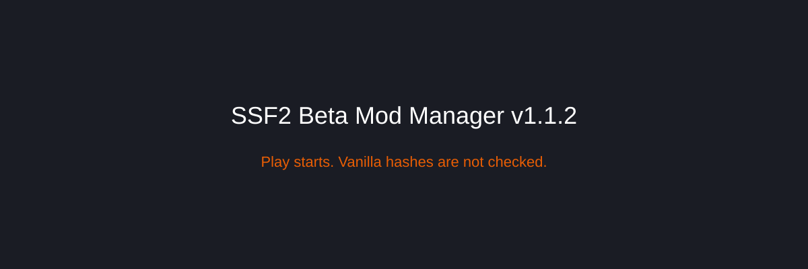

Setup on another PC could build SSF2 Shell and then stop at Play. The manager listed vanilla files that missed a hash, and the game then said `engine2.swf` was modified and would not start.

v1.1.2 drops the vanilla file hash check. The Shell also loads `engine2.swf` without that pin. Expansion mods that fail the security check still do not start.

Check Updates installs this manager, then rebuilds SSF2 Shell. Accept the Shell rebuild so Play uses the new booter.
