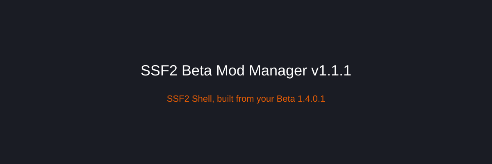

## The revamp

SSF2 Beta Mod Manager no longer mods the copy of the game you installed. It builds **SSF2 Shell**, a moddable game, from your own **SSF2 Beta 1.4.0.1**. Play starts the Shell. The vanilla install stays where it is.

Three downloads do this. You only run the manager. It fetches the other two.

- **SSF2 Beta Mod Manager** is the launcher. It browses GameBanana, turns mods on and off, and Make Mods lives here.
- **SSF2 Shell** is the game. The manager downloads [SSF2 Shell Base](https://github.com/SSF2-Mods-Official/SSF2-Shell-Base) and builds the Shell next to the manager. A later Shell update rebuilds it and keeps your mods and settings.
- **Next2Flash** compiles and decompiles. Setup downloads it, including portable Python and Java. You do not install those yourself. Event scripts compile with it. The game classes come from the Shell's own event file.

The manager does not ship SSF2. You still need Beta 1.4.0.1 on the PC.

## Setup

Setup opens the first time you launch. You can open it again from **Settings → Run setup**.

1. **Next2Flash.** Download it, or pick a folder you already have.
2. **Your game.** Pick the folder that contains `SSF2.swf`.
3. **SSF2 Shell.** The manager downloads the patches and builds the Shell. The first build takes about a minute.
4. **Debugging** is optional. It sets up VS Code or Cursor for ActionScript.

If `SSF2.swf` or the mappings file is not the 1.4.0.1 copy, the manager names those files and asks once for that folder. Continue builds anyway. At Play, vanilla files in the Shell that do not match are listed once. An expansion mod that fails the security check still does not start.

## What you can do

**Play** starts SSF2 Shell. **Configure** chooses the screen, match, or event it opens into, plus the boot intro and music.

**Download Mods** browses GameBanana. 1-Click still uses `ssf2mm:` links. Mods made for 0.9b stay hidden unless you ask for them. **Manage Mods** turns packs on and off. Changes apply the next time the game starts.

**Make Mods** covers events, costumes, music, boot intros, stages, and characters. Costume editing includes Palette Maker. The original Palette Maker is by VAL. IDK is by David (stariwinkle).

**JPEXS** is on the sidebar. It opens the copy that came with Next2Flash.

## Updates

**Check Updates** looks at the manager, Next2Flash, and SSF2 Shell together and asks once. Yes copies only the files that changed. A Shell you built from source is left alone. A Next2Flash source checkout is left alone.

Settings stay in `%AppData%\SSF2ModManager\`. Player data for the Shell (playlists, controller profiles) stays in `SSF2 Shell\expansions\user`.
