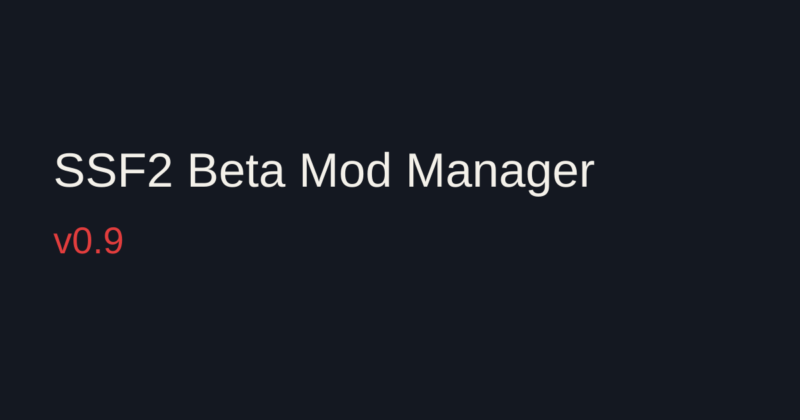

This is a fresh 0.9. Delete the old Mod Manager and download this one.

Setup shows one step at a time, and the main window stays hidden until setup is complete. Next2Flash is saved in a folder next to the Mod Manager. News has a Check for updates button. When the manager itself updates, it says it will restart, then it quits and starts again.

SSF2 Shell 0.9 keeps the waiting-room song separate from the camera background, sends that background to the other player in an online match, and ships with debug off. F5 still turns lazy debug on.
