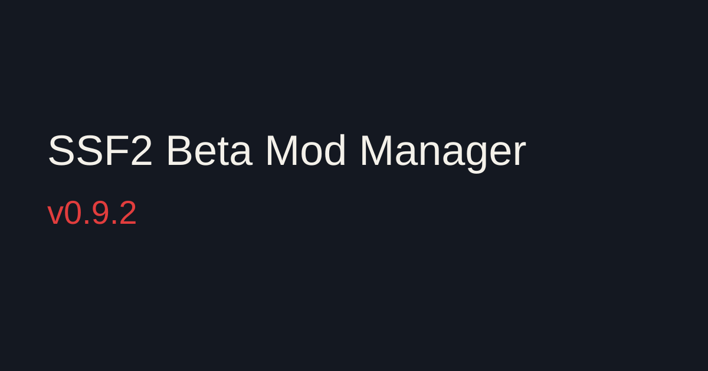

The shell builds from the 64-bit installer, the 64-bit portable, the 32-bit installer, and the 32-bit portable. A 32-bit copy starts on that game's Adobe AIR, with Discord and rumble. A 64-bit copy keeps the 64-bit Discord and rumble files.
