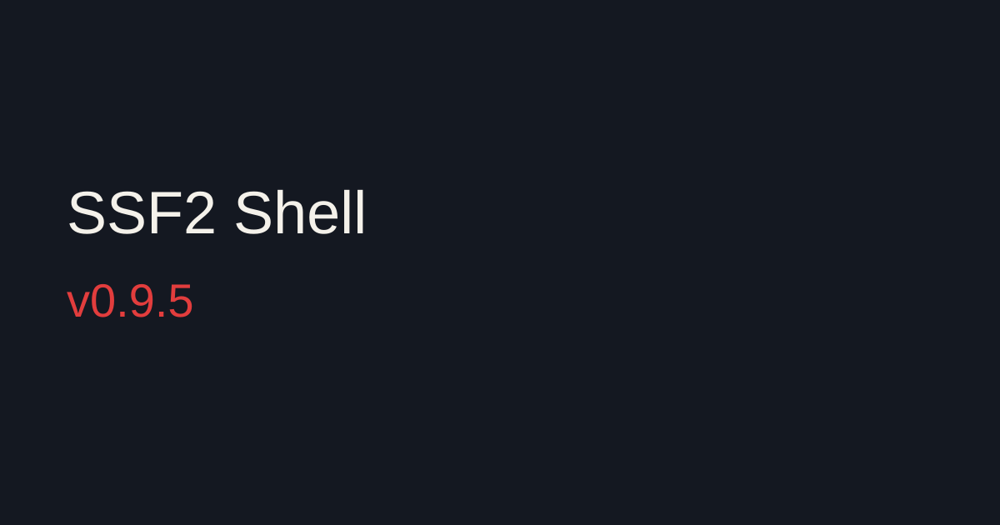

Saving a Bowser or Giga Bowser costume opens the same pair list as Zelda and Sheik. Base on Giga Bowser is Giga 1. The player portrait recolors colors from the body palette as well as the portrait palette, and it does not redraw on every move.

Zelda and Sheik in Palette Maker stand together on one team. Player 1's pad moves both, and Start stays on player 1. A palette pick shows on the other form at the same slot. Base uses that form's stock colors. Those Base tiles stay out of the Color Vault grid.

Menu music stays on the song that is already playing when it ends. Taking the last song off the Menu Music list returns to the stock menu track.

Holding Back stays on the character select that is on screen. The menu background comes back after a match, and the results screen stays up after a win clip.

Update it in the Mod Manager. Open **News** and click **Check for updates**, or restart the Mod Manager.
