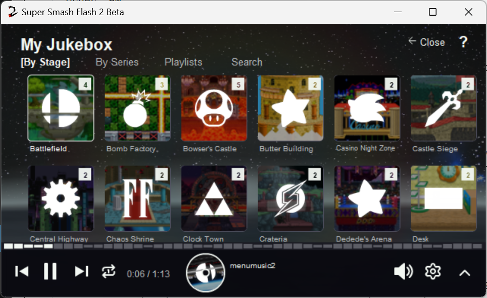

The strip on the manager is a remote for [My Jukebox](../SSF2 Shell Features/my-jukebox.md). It is not a second music engine. The game still owns the song.

## What you can do with it

Play, pause, pick another song, and scrub. The bars next to it move with the song that is loaded. Setup prepares the song list and the previews when Shell is built, so the list is there the first time you open the manager.

## Settings that change it

**Settings** has two checkboxes:

- **Pause music when the game launches.** Stops this player when SSF2 starts.
- **Sync music with the game.** On by default. While SSF2 is open, this player stays silent and follows whatever My Jukebox is playing, including when you change menus. Pick a song here and the game plays it. If the jukebox screen is closed, the in-game song banner still shows. The manager checks the game about twice a second. It does not sit in the match loop.

Closing the game pauses this player and turns its volume back up.

A song you pick in **Configure** while the game is open is the same override. **Set to default** there clears it.
